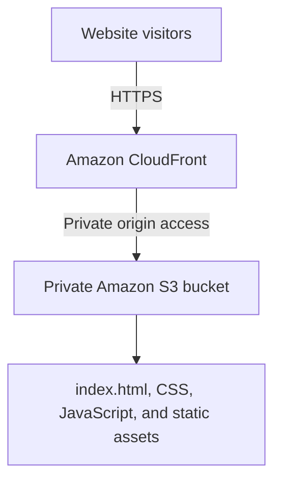

# AWS Cloud Portfolio

A responsive personal portfolio showcasing cloud, networking, and engineering projects. The site is hosted in a private Amazon S3 bucket and delivered through Amazon CloudFront over HTTPS.

> **Status:** Deployed. The website loads through CloudFront. Direct access to the S3 `index.html` URL returned `AccessDenied` in an Incognito test. The deployment walkthrough and sanitized screenshot evidence are included. GitHub Actions deployment workflow has been added; AWS OIDC configuration is still required before automatic deployments can run.

## Live website

- **CloudFront URL:** https://d4onyd9a8q3si.cloudfront.net
- **AWS Region:** `us-east-1` (US East, N. Virginia)

## Architecture



CloudFront uses the S3 bucket as its origin, private-origin access is enabled, and `index.html` is the default root object. S3 Block Public Access remains enabled.

## Technology stack

- **Frontend:** HTML5, CSS3, JavaScript
- **Storage:** Amazon S3
- **Content delivery and HTTPS:** Amazon CloudFront
- **Origin access:** CloudFront private S3 origin access / OAC
- **Version control:** Git and GitHub

## Repository structure

```text
aws-cloud-portfolio/
├── index.html
├── assets/css/style.css
├── assets/js/script.js
├── docs/
│   ├── architecture.md
│   ├── deployment-notes.md
│   └── deployment-walkthrough.md
├── screenshots/
└── README.md
```

## Deployment summary

1. Created S3 bucket `oday-static-website-2026` in `us-east-1`.
2. Kept S3 Block Public Access enabled.
3. Uploaded `index.html` and the `assets/` directory.
4. Created CloudFront distribution `aws-cloud-portfolio-cdn` with the S3 bucket as origin.
5. Enabled CloudFront access to the private S3 origin.
6. Set `index.html` as the default root object.
7. Confirmed that the CloudFront HTTPS URL loads.
8. Tested the direct S3 `index.html` URL in Incognito; S3 returned `AccessDenied`.

## Documentation and evidence

- [Deployment notes](docs/deployment-notes.md)
- [Architecture](docs/architecture.md)
- [Step-by-step walkthrough with screenshot captions](docs/deployment-walkthrough.md)
- [Screenshot evidence guide](screenshots/README.md)\n- [GitHub Actions automatic deployment setup](docs/github-actions-deployment.md)

## Validation checklist

- [x] Website files uploaded to S3
- [x] CloudFront distribution created
- [x] `index.html` set as default root object
- [x] Website loads from CloudFront over HTTPS
- [x] Direct S3 `index.html` request returned `AccessDenied`
- [ ] Verify navigation, CSS, and JavaScript assets on desktop and mobile
- [ ] Add sanitized screenshots to the repository

## Security and cost

Keep the S3 bucket private; visitors should use CloudFront. Never commit AWS access keys, session tokens, passwords, or other secrets. AWS charges may apply depending on usage, requests, and data transfer. Review AWS Billing regularly and remove resources when the project is no longer needed.

## Author

**Oday Haitham Metwalli** — Electronics Engineering student interested in cloud computing, cloud architecture, and networking.
