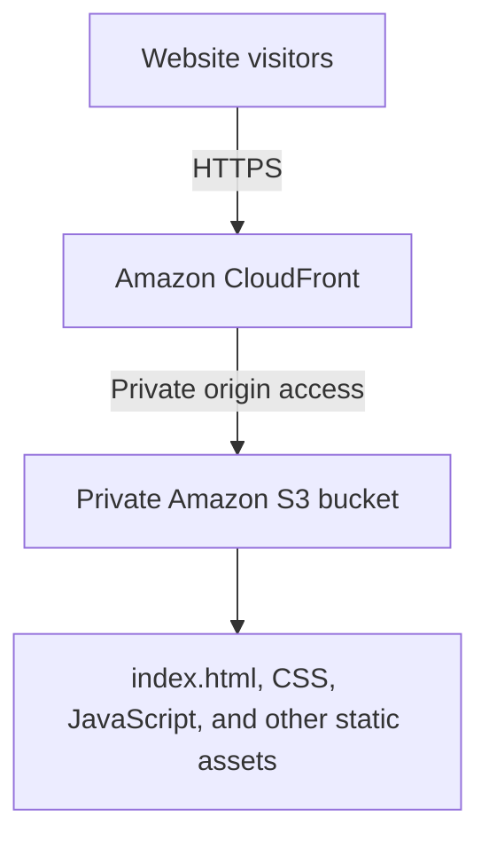

# AWS Cloud Portfolio

A responsive personal portfolio for showcasing cloud, networking, and engineering projects. The site is hosted in a private Amazon S3 bucket and delivered through Amazon CloudFront over HTTPS.

> **Status:** Deployed. The website is available through CloudFront. Security and final validation checks are still in progress.

## Live website

- **CloudFront URL:** https://d4onyd9a8q3si.cloudfront.net
- **AWS Region:** `us-east-1` (US East, N. Virginia)

## Objectives

- Build a responsive portfolio using HTML, CSS, and JavaScript.
- Store static assets in Amazon S3.
- Keep the S3 bucket private and grant CloudFront access.
- Serve the site through CloudFront over HTTPS.
- Document implementation steps and validation results.

## Architecture



CloudFront is configured with the S3 bucket as its origin, private-origin access enabled, and `index.html` as the default root object. S3 Block Public Access remains enabled.

## Technology stack

- **Frontend:** HTML5, CSS3, JavaScript
- **Storage:** Amazon S3
- **Content delivery and HTTPS:** Amazon CloudFront
- **Origin access:** CloudFront private S3 origin access / Origin Access Control (OAC)
- **Version control:** Git and GitHub

## Repository structure

```text
aws-cloud-portfolio/
├── index.html
├── assets/
│   ├── css/style.css
│   └── js/script.js
├── docs/
│   ├── architecture.md
│   └── deployment-notes.md
├── screenshots/README.md
├── .gitignore
└── README.md
```

## Deployment summary

1. Created the S3 general-purpose bucket `oday-static-website-2026` in `us-east-1`.
2. Kept S3 Block Public Access enabled.
3. Uploaded `index.html` and the `assets/` directory.
4. Created the CloudFront distribution `aws-cloud-portfolio-cdn` with the S3 bucket as its origin.
5. Enabled CloudFront access to the private S3 origin.
6. Set `index.html` as the default root object.
7. Opened the CloudFront URL and confirmed that the website loads.

See [deployment notes](docs/deployment-notes.md) for the current configuration and remaining checks.

## Validation checklist

- [x] Website loads from the CloudFront URL over HTTPS
- [x] `index.html` is configured as the default root object
- [x] Website files uploaded to S3
- [ ] Confirm direct S3 object URLs are not publicly readable
- [ ] Verify responsive layout and navigation on desktop and mobile
- [ ] Add sanitized screenshots of the deployment
- [x] No AWS credentials or tokens are intentionally included in the repository

## Security and cost

Keep the S3 bucket private; public visitors should use CloudFront. Never commit AWS access keys, session tokens, passwords, or other secrets. AWS charges may apply depending on usage, requests, and data transfer. Review AWS Billing and current pricing regularly, and remove resources when the project is no longer needed.

## Evidence

Sanitized screenshots from actual AWS configuration and deployment stages will be added to `screenshots/` as work progresses. Hide account identifiers where practical and never include credentials or secrets.

## Author

**Oday Haitham Metwalli** — Electronics Engineering student interested in cloud computing, cloud architecture, and computer networking.
