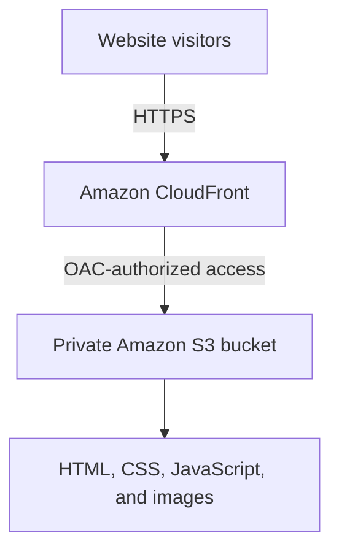

# AWS Cloud Portfolio

A responsive personal portfolio for showcasing cloud, networking, and engineering projects. The website is designed to be stored in Amazon S3 and delivered through Amazon CloudFront over HTTPS.

> **Status:** In progress. The S3 bucket has been created; website upload and CloudFront configuration are upcoming.

## Objectives
- Build a responsive portfolio using HTML, CSS, and JavaScript.
- Store static assets in Amazon S3.
- Keep the S3 bucket private and grant CloudFront access with Origin Access Control (OAC).
- Serve the site through CloudFront over HTTPS.
- Document implementation steps with screenshots and validation results.

## Planned architecture


## Technology stack
- Frontend: HTML5, CSS3, JavaScript
- Storage: Amazon S3
- Content delivery and HTTPS: Amazon CloudFront
- Origin security: CloudFront Origin Access Control (OAC) and an S3 bucket policy
- Version control: Git and GitHub

## Repository structure
```text
aws-cloud-portfolio/
├── index.html
├── assets/css/style.css
├── assets/js/script.js
├── docs/architecture.md
├── docs/deployment-notes.md
├── screenshots/README.md
├── .gitignore
└── README.md
```

## Deployment plan
1. Create an S3 general-purpose bucket in `us-east-1`.
2. Keep Block Public Access enabled.
3. Upload the website files.
4. Create a CloudFront distribution with the S3 bucket as origin.
5. Configure OAC and a bucket policy scoped to the distribution.
6. Set `index.html` as the default root object and verify HTTPS access.
7. Test navigation, assets, responsive layout, and direct S3 access.
8. Add screenshots and final validation results.

## Validation checklist
- [ ] Responsive layout checked on desktop and mobile
- [ ] Navigation links work
- [ ] Static assets load successfully
- [ ] CloudFront URL serves the site over HTTPS
- [ ] S3 objects are not publicly readable directly
- [ ] No credentials or tokens are committed

## Security and cost
Keep the S3 bucket private; public visitors should use CloudFront. Never commit AWS access keys, session tokens, or other secrets. AWS charges may apply depending on usage, region, requests, and data transfer. Review current pricing and billing, and remove resources when the project is no longer needed.

## Evidence
Screenshots from actual AWS configuration and deployment stages will be added to `screenshots/` as work progresses.

## Author
**Oday Haitham Metwalli** — Electronics Engineering student interested in cloud computing, cloud architecture, and computer networking.
