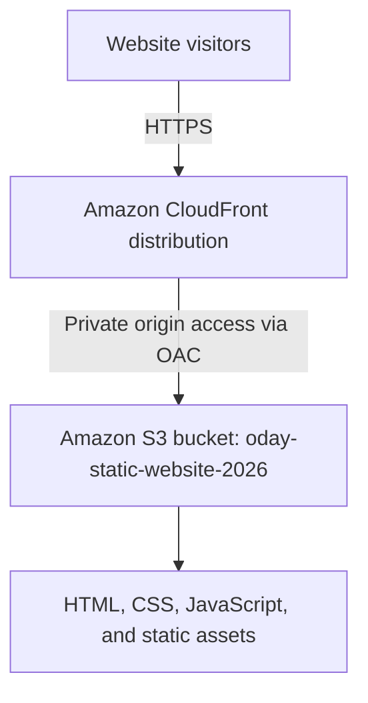

# AWS Architecture

## Target design

## Components

- **Amazon S3:** stores the static website files. Block Public Access remains enabled.
- **Amazon CloudFront:** serves the website globally and provides HTTPS.
- **Origin Access Control (OAC):** allows CloudFront to access the private S3 origin.
- **S3 bucket policy:** will grant read access to the intended CloudFront distribution only.

## Current state

- S3 bucket created in US East (N. Virginia), `us-east-1`.
- S3 Block Public Access is enabled.
- No bucket policy is configured yet.
- CloudFront distribution has not yet been created.

The diagram represents the intended design, not a claim that the deployment is complete.
