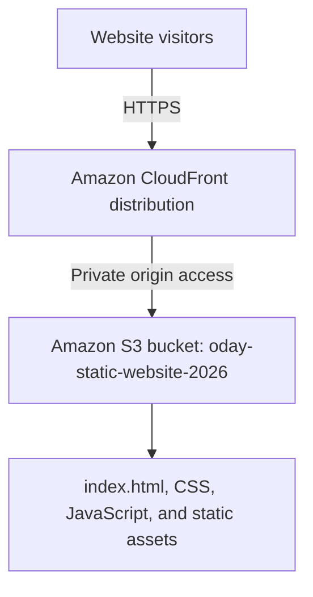

# AWS Architecture

## Deployed design

## Components

- **Amazon S3:** stores the static website files. Block Public Access remains enabled.
- **Amazon CloudFront:** serves the website through its CloudFront domain over HTTPS.
- **Private origin access:** CloudFront access to the S3 origin was enabled during distribution setup.
- **Default root object:** `index.html`.

## Current deployment state

- S3 bucket: `oday-static-website-2026`
- Region: US East (N. Virginia), `us-east-1`
- CloudFront distribution name: `aws-cloud-portfolio-cdn`
- CloudFront domain: https://d4onyd9a8q3si.cloudfront.net
- The website was opened using the CloudFront HTTPS URL and confirmed to load.
- S3 Block Public Access remains enabled.
- Direct S3 access denial and responsive/mobile checks are still pending.

## Request flow

1. A visitor opens the CloudFront URL using HTTPS.
2. CloudFront serves cached content or retrieves the requested static file from the S3 origin.
3. CloudFront uses the configured private-origin access to retrieve content from S3.

The architecture reflects the deployment completed so far. Remaining security and compatibility checks are tracked in [deployment notes](deployment-notes.md).
