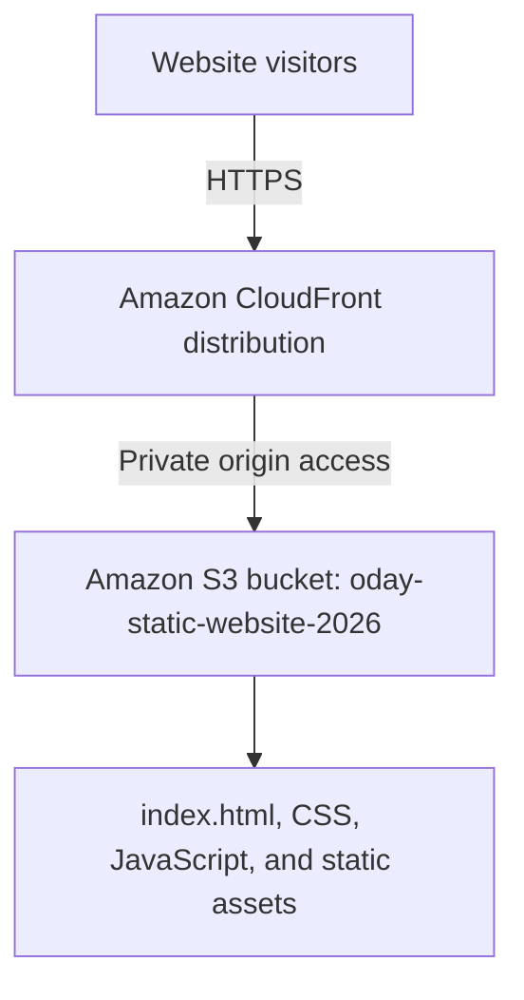

# AWS Architecture

## Deployed design

## Components

- **Amazon S3:** stores static website files. Block Public Access remains enabled.
- **Amazon CloudFront:** serves the website through its CloudFront domain over HTTPS.
- **Private origin access:** CloudFront access to the S3 origin was enabled during distribution setup.
- **Default root object:** `index.html`.

## Current deployment state

- **S3 bucket:** `oday-static-website-2026`
- **Region:** `us-east-1`
- **CloudFront distribution:** `aws-cloud-portfolio-cdn`
- **CloudFront domain:** https://d4onyd9a8q3si.cloudfront.net
- The website loads from the CloudFront URL.
- Direct access to the S3 `index.html` URL was tested and returned `AccessDenied`.
- The layout includes responsive CSS; a final manual mobile/browser check should still be completed.

## Request flow

1. A visitor opens the CloudFront URL using HTTPS.
2. CloudFront serves cached content or retrieves a static file from the S3 origin.
3. CloudFront uses the configured private-origin access to retrieve content from S3.

See [deployment notes](deployment-notes.md) and the [step-by-step walkthrough](deployment-walkthrough.md) for implementation details and evidence.
