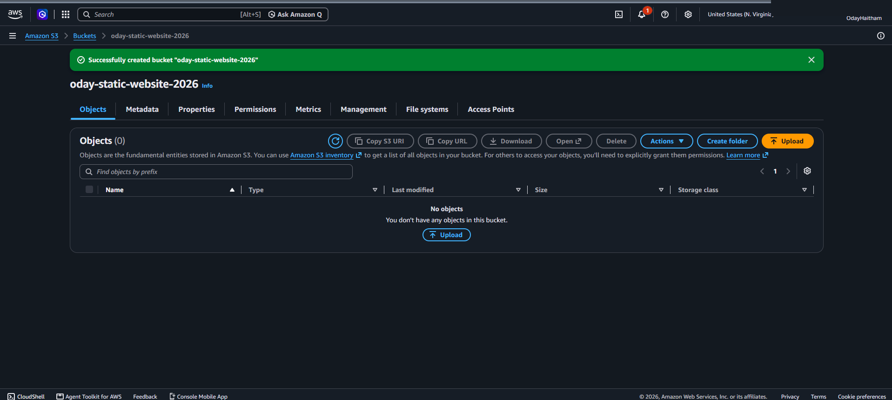
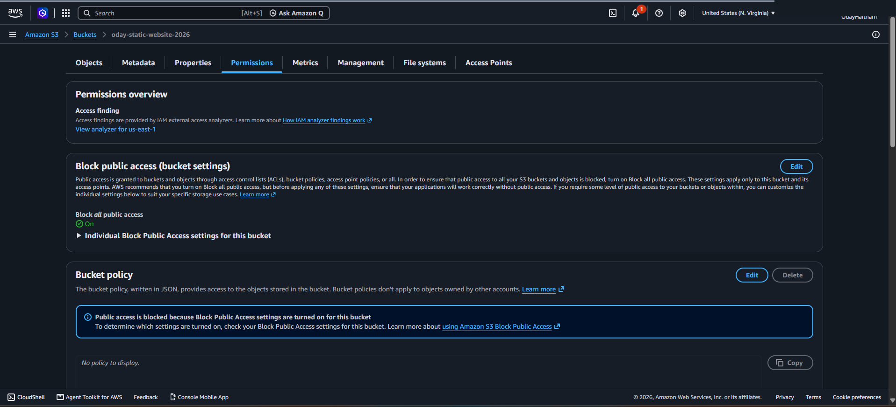
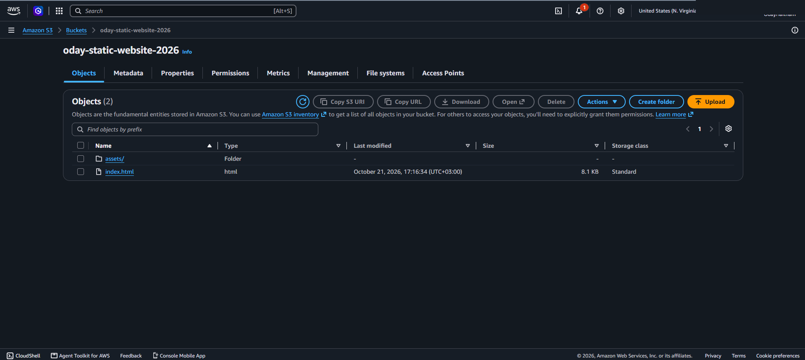
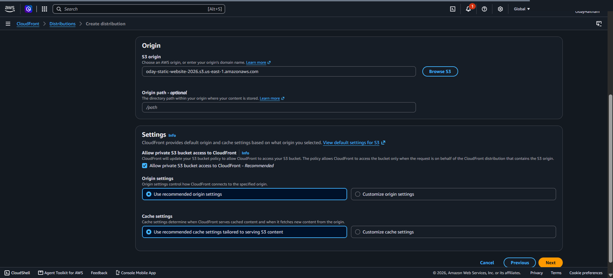
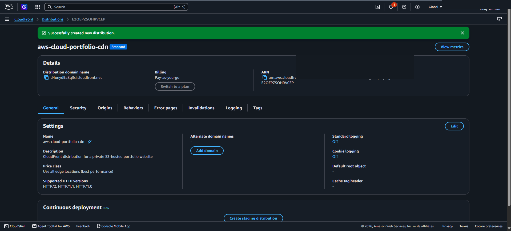
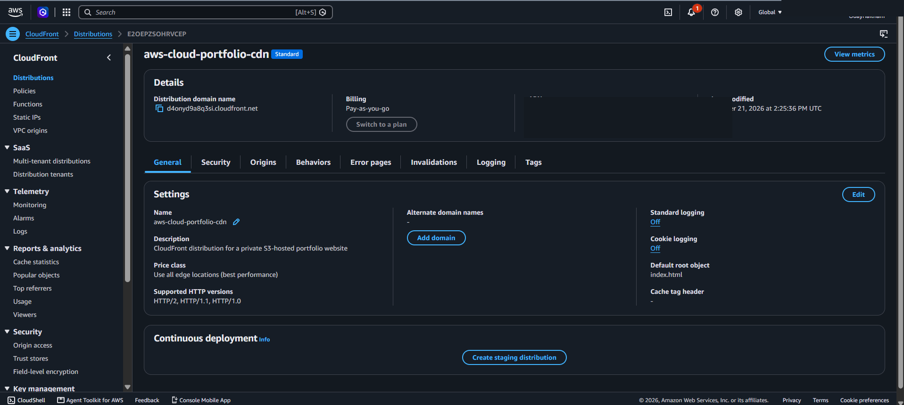
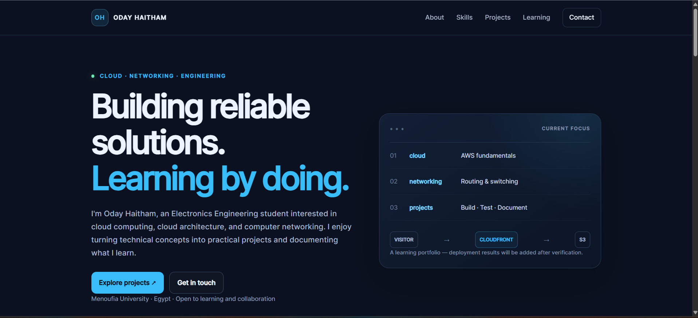
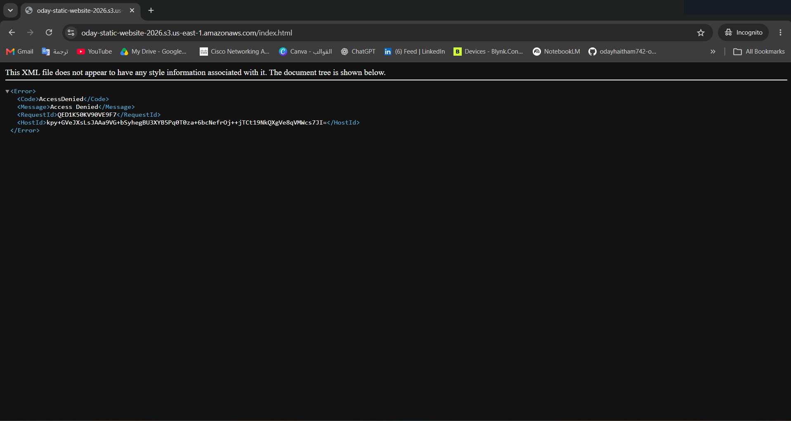

# Deployment Walkthrough

This guide records the actual deployment stages and explains what each screenshot demonstrates. Upload the sanitized PNGs to the repository's `screenshots/` folder using the filenames shown below. The images will render inline after those files are committed.

## 1. Create the S3 bucket

**Evidence file:** `screenshots/01-s3-bucket-created.png`

**What was done:** Created the general-purpose S3 bucket `oday-static-website-2026` in `us-east-1`.

**Why it matters:** S3 stores the static HTML, CSS, and JavaScript files that CloudFront will deliver.

## 2. Keep S3 private

**Evidence file:** `screenshots/02-s3-public-access-blocked.png`

**What was done:** Kept S3 Block Public Access enabled.

**Why it matters:** Visitors should not fetch site files directly from public S3 URLs. CloudFront is the public entry point.

## 3. Upload the website files

**Evidence file:** `screenshots/03-s3-website-files-uploaded.png`

**What was done:** Uploaded `index.html` to the bucket root and the `assets/` folder containing `css/style.css` and `js/script.js`.

**Why it matters:** The root page and asset paths must match the references used by the website for styling and navigation to load.

## 4. Configure CloudFront to access the private origin

**Evidence file:** `screenshots/04-cloudfront-origin-private-access.png`

**What was done:** Created a CloudFront distribution with the S3 bucket as its origin and enabled the recommended private S3 origin access option.

**Why it matters:** CloudFront can retrieve site files while the bucket remains private. The origin should be the S3 bucket origin, not the S3 static website endpoint.

## 5. Create the distribution

**Evidence file:** `screenshots/05-cloudfront-distribution-created.png`

**What was done:** Created the distribution named `aws-cloud-portfolio-cdn`. AWS assigned the domain `d4onyd9a8q3si.cloudfront.net`.

**Why it matters:** CloudFront provides the HTTPS endpoint used by visitors. The distribution must finish deploying before testing.

## 6. Set the default root object

**Evidence file:** `screenshots/06-cloudfront-default-root-object.png`

**What was done:** Set the distribution's default root object to `index.html`.

**Why it matters:** Visitors opening the base CloudFront domain should receive the portfolio home page without typing `/index.html`.

## 7. Test the live website

**Evidence file:** `screenshots/07-cloudfront-website-live.png`\n\n

**What was done:** Opened the CloudFront HTTPS URL and confirmed the portfolio loads.

**Why it matters:** This confirms the deployed site is reachable through the intended public endpoint. Follow-up checks should also confirm CSS, JavaScript, links, and responsive layout.

## 8. Test direct S3 access

**Evidence file:** `screenshots/08-s3-direct-access-denied.png`

**What was done:** Opened the direct S3 `index.html` URL in an Incognito window. The response showed `AccessDenied`.

**Why it matters:** This is evidence that the tested object is not publicly readable through its direct S3 URL. It does not by itself audit every object or every bucket-policy condition.

## Screenshot safety checklist

- Hide AWS account IDs and ARNs containing the account ID.
- Never include access keys, passwords, session tokens, or other credentials.
- Keep meaningful settings visible so the screenshot proves the step.
- Use screenshots from the actual project, not mockups or fabricated console images.
